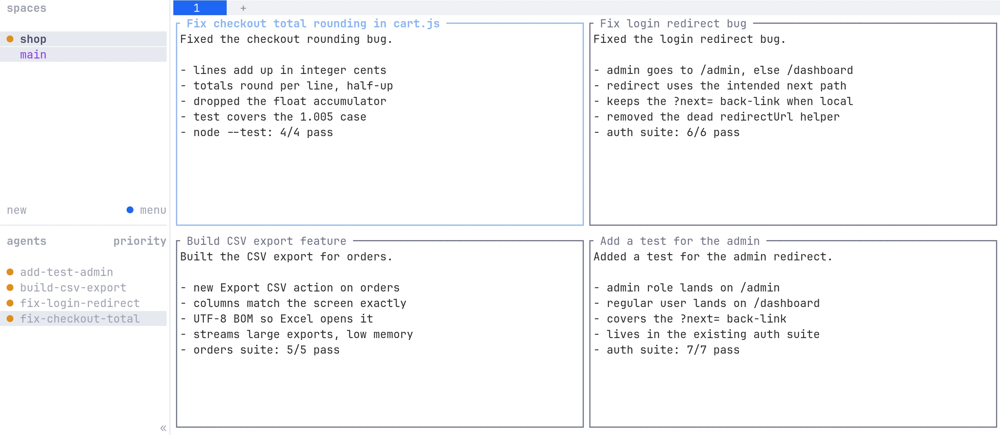
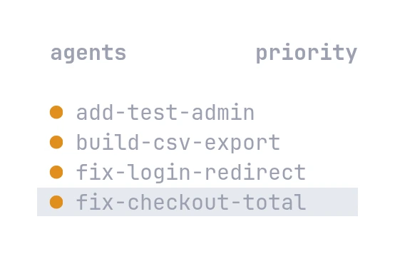
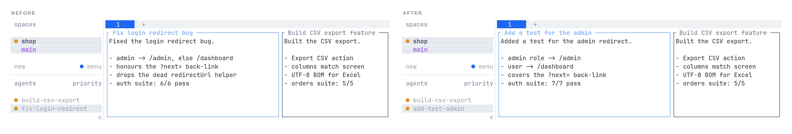

<h1 align="center">herdr-task-titles</h1>

<p align="center">
  <strong>Every agent a name. Every task a title.</strong>
</p>

<p align="center">
  <a href="https://github.com/umeranjum17/herdr-task-titles/actions/workflows/ci.yml"></a>
  <a href="LICENSE"></a>
  
  
</p>

<p align="center">
  A <a href="https://herdr.dev">Herdr</a> plugin that names each agent after its work and titles each pane<br/>
  with what that agent is doing — so a screen full of agents is easy to read at a glance.
</p>

<p align="center">
  <a href="#quick-start"><strong>Install &amp; quick start</strong></a> · <a href="#features">Features</a> · <a href="#configure">Configure</a>
</p>

<p align="center">
  <picture>
    <source media="(prefers-color-scheme: dark)" srcset="docs/hero-dark.webp" />
    
  </picture>
</p>

## Why

Run a few agents side by side and they all look the same: every pane says `pi` or `claude`, every agent is unnamed, and finding the one fixing the login bug means reading terminals. This plugin gives each agent a name and each pane a title from the work it was given, so you can glance at the screen and know which is which.

## See it in action

### A name from the work

Each agent is named after what it is doing — a task id from an `fm/<task-id>` branch, or a short name from the task title (`Fix login redirect bug` → `fix-login-redirect`). Two agents on the same work become `shop` and `shop-2`.

<p align="center">
  <picture>
    <source media="(prefers-color-scheme: dark)" srcset="docs/names-dark.webp" />
    
  </picture>
</p>

### A title from the task

The pane title comes from the strongest signal available, in order: the task you gave the agent, read from its latest prompt; the task branch it is working on; or the repository name. A title from a prompt is a few plain words, and unclear prose is skipped rather than guessed at.

Give the agent a new task and the title (and its name) follow. When the agent exits, the title is cleared.

<p align="center">
  <picture>
    <source media="(prefers-color-scheme: dark)" srcset="docs/task-change-dark.webp" />
    
  </picture>
</p>

## Quick start

You need [Herdr](https://herdr.dev) 0.8.0 or newer and [Node.js](https://nodejs.org/) 22.18 or newer, on Linux or macOS.

1. **Install** the plugin.

   ```sh
   herdr plugin install umeranjum17/herdr-task-titles
   ```

2. **Confirm** it is enabled — `herdr plugin list` shows `herdr.task-titles`.

   ```sh
   herdr plugin list
   ```

3. **Start an agent.** In any pane start `pi`, `claude`, `codex`, or `opencode` and give it a task. It gets a name in the sidebar, and its pane shows what it is working on.

Update an existing install with:

```sh
herdr plugin install umeranjum17/herdr-task-titles --yes
```

## Features

- **Names from the work.** A task id from an `fm/<task-id>` branch, or a short name from the task title.
- **Titles from the task.** Each pane shows what the agent is working on, in a few plain words.
- **Keeps up.** A new task updates the title and name; exiting clears the title.
- **Plays fair.** A name or title you set is never replaced, and it steps aside if another naming plugin is enabled.
- **Local only.** Prompts are read from the agent's own session files on your machine — no network calls. Its one npm dependency (`@byokit/herdr`, pinned) installs with the plugin.
- **Any agent you already use.** pi, Claude Code, Codex, and opencode.

## Use the agents you already have

Names work for any agent Herdr detects. Task titles read prompts from:

- pi
- Claude Code
- Codex
- opencode (needs Node.js 22.5 or newer, or the `sqlite3` command)

## Configure

Settings live in `settings.json` in the plugin's config directory:

```sh
herdr plugin config-dir herdr.task-titles
```

With no settings file, the defaults are `{ "enabled": true, "names": "work" }`.

Prefer names you can say out loud? Choose a name set with `names`:

```json
{ "names": "nato" }
```

| `names` | Agents are named |
|---|---|
| `work` (default) | after their work, as above |
| `nato` | alpha, bravo, charlie, delta … zulu |
| `elements` | neon, gold, zinc, cobalt, silver, helium … |
| `off` | not at all; task titles still work |

### Turn it off

Pause names and titles:

```json
{ "enabled": false }
```

Or disable or remove the plugin:

```sh
herdr plugin disable herdr.task-titles
herdr plugin uninstall herdr.task-titles
```

## Development

```sh
git clone https://github.com/umeranjum17/herdr-task-titles
cd herdr-task-titles
npm ci
npm test
```

`npm test` runs one end-to-end journey against a real, isolated Herdr session it starts itself. Adding a provider means one adapter file in `providers/` and one line in `providers/index.mjs`.

## License

MIT. See [LICENSE](LICENSE).
